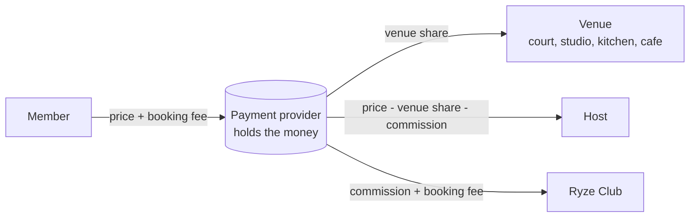
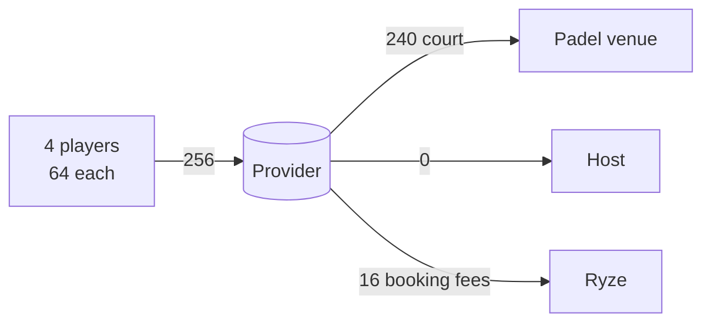
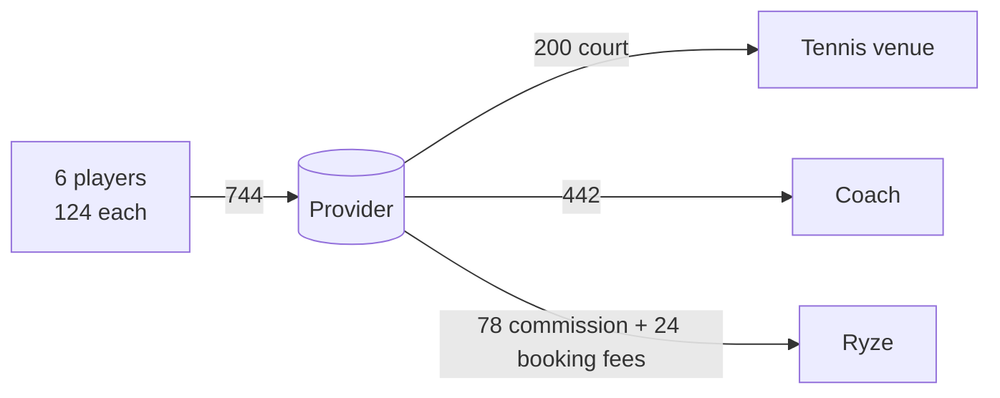
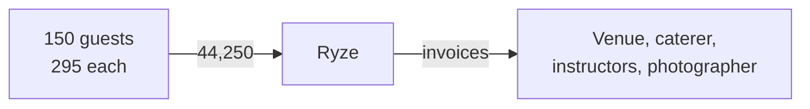
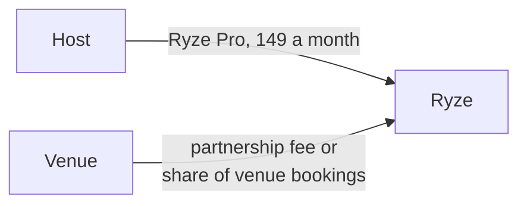

# Money flows

How money moves for every type of club on Ryze Club. Who pays, who receives what, and what Ryze keeps. This holds whichever payment provider is used. Card fees are left out of the examples; section 6 covers who bears them.

## 1. The rules

These are the proposed fee rules. Section 5 of the business plan has the options; the rates are not yet decided (D39).

1. **The member pays the session price plus a member booking fee**: AED 2 for sessions under AED 40, AED 4 from AED 40.
2. **The venue share goes to the venue and Ryze takes no commission on it.** This covers the court, pitch, studio, kitchen or cafe minimum spend, plus an instructor the host hires at cost.
3. **Ryze takes 15% commission on what the host keeps**, meaning the price minus the venue share. A pure cost-share session, where the host keeps nothing, pays no commission.
4. **For the first month an organiser pays no commission.** The member booking fee still applies.
5. **Ryze never holds members' money**, except for its own Mind Body Soul days. The payment provider holds it and pays out to the host and venue after the session.

When the venue is not on Ryze, the host states the venue cost per player and receives it with their payout, then pays the venue themselves. Ryze checks the stated cost is close to the venue's price divided by the number of players, so a session cannot be passed off as cost-share.

### The general flow

## 2. Every type of club

All amounts are AED per session. "Paid" is what all members pay together, including booking fees. The venue costs are illustrative; confirm real ones with the pilot clubs.

| # | Club type | Example | Price | Paid | Venue | Host keeps | Ryze |
|---|---|---|---:|---:|---:|---:|---:|
| A | **Free club** | Marina run club, beach volleyball | 0 | 0 | 0 | 0 | 0 |
| B | **Cost-share, venue on Ryze** | Padel: 4 players, court AED 240 an hour | 60 | 256 | 240 | 0 | 16 |
| B2 | **Cost-share, host pays the venue** | Five-a-side: 10 players, pitch AED 400 | 40 | 440 | — | 400, then pays the pitch | 40 |
| C | **Cost-share, hired instructor** | Pilates in the park: 15 people, instructor AED 300 | 20 | 330 | 300 to the instructor | 0 | 30 |
| C2 | **Instructor is the host** | Same class, run by the instructor | 20 | 330 | 0 | 255 | 75 |
| D | **Coach-led, at a venue** | Tennis clinic: 6 players, court AED 200 | 120 | 744 | 200 | 442 | 102 |
| E | **Studio or venue runs the club** | Boxing studio class: 12 people | 90 | 1,128 | — (studio is the host) | 918 | 210 |
| F | **Book club, ticket includes a drink** | 12 people, AED 25 drink to the cafe | 70 | 888 | 300 | 459 | 129 |
| F2 | **Free book club at a partner cafe** | Members buy their own coffee | 0 | 0 | 0 | 0 | Venue partnership fee |
| G | **Supper club or cooking class** | 10 people, kitchen AED 400, ingredients bought by the host | 180 | 1,840 | 400 | 1,190 (about 690 after ingredients) | 250 |
| H | **One-off workshop at a studio** | Pottery taster: 14 tickets | 250 | 3,556 | — (studio is the host) | 2,975 | 581 |
| I | **Monthly pass** | Run coaching: AED 200 a month for 8 sessions | 200 | 204 per member | 0 | 170 | 34 |
| J | **Ryze Mind Body Soul day** | 150 tickets at AED 295 | 295 | 44,250 | 25,500 to suppliers | — | 10,750 after AED 8,000 fixed costs |
| K | **Ryze Pro** | Host's monthly plan | — | — | — | — | 149 a month, paid by the host |
| L | **Venue partnership** | Cafe, studio or pitch featured as a Ryze venue | — | — | — | — | Monthly fee, or a share of the venue's bookings |

How the main examples work out:

- **B. Padel.** Each player pays 60 + 4 = 64. The court gets 4 × 60 = 240. The host keeps nothing, so there is no commission. Ryze gets 4 × 4 = 16. The host no longer fronts the court or chases payments.
- **B2. Five-a-side, pitch not on Ryze.** The host states the pitch cost (AED 40 a player) and receives it with their payout. Ryze gets 10 × 4 = 40.
- **C2. Instructor is the host.** Commission is 15% × 20 = 3 a person. The instructor keeps 17 × 15 = 255. Ryze gets (3 + 2) × 15 = 75.
- **D. Tennis clinic.** The court share is 200 ÷ 6 = 33.33 a player, which leaves 86.67 for the coach. Commission is 15% × 86.67 = 13. The coach keeps 73.67 × 6 = 442. Ryze gets (13 + 4) × 6 = 102.
- **E. Boxing studio.** Commission is 15% × 90 = 13.50. The studio keeps 76.50 × 12 = 918. Ryze gets 17.50 × 12 = 210.
- **F. Book club.** The cafe gets 25 × 12 = 300 for the drinks. The host part is 45, and commission is 6.75. The host keeps 38.25 × 12 = 459. Ryze gets 10.75 × 12 = 129.
- **G. Supper club.** The kitchen gets 400 (40 a guest). The host part is 140, and commission is 21. The host keeps 119 × 10 = 1,190, about 690 after ingredients. Ryze gets 25 × 10 = 250.
- **I. Monthly pass.** Commission is 15% × 200 = 30, plus one AED 4 booking fee for the pass.

## 3. The four patterns

### Cost-share sessions (B, B2, C)

The host organises and the members split the venue or instructor cost. Ryze earns only the booking fee.

### Earning hosts (C2, D, E, F, G, H, I)

A coach, studio, chef, artist or book club host who earns from the session. Ryze takes 15% of what the host keeps, after the venue share.

### Ryze's own events (J)

This is the only flow where Ryze is the seller and holds the money. It sells the tickets, pays its suppliers against their invoices, and charges VAT on the full ticket once registered. It also needs the event permit and insurance (business plan, section 10).

### Money from hosts and venues (K, L)

## 4. When money moves

| Moment | What happens |
|---|---|
| **Member books** | Card or Apple Pay is charged in full: price plus booking fee. The provider holds the money |
| **Session full** | No charge. A waitlist spot is charged only when it is confirmed |
| **24 hours before** | The free cancellation window closes. Members can still give their spot to a friend |
| **Session happens** | Check-in confirms who came (organiser app) |
| **2 days after** | Payout: venue share to the venue, host share to the host, Ryze's part to Ryze. Holding until after the session makes refunds simple |
| **Monthly pass** | Charged on the same day each month. Paid out monthly |

## 5. Refunds, cancellations and disputes

| Case | Member gets back | Venue | Host | Ryze |
|---|---|---|---|---|
| Member cancels more than 24 hours before | The price; the booking fee is kept | Nothing | Nothing | Keeps the booking fee only |
| Member cancels late or doesn't turn up | Nothing | Paid | Paid | Paid |
| Member gives their spot to a friend | Settled between the two members | Paid | Paid | Paid |
| **Host cancels** (illness, weather, venue problem) | Everything, including the booking fee | Venue's own policy; Ryze shows it on the session | Nothing | Nothing. Streak protected (D28) |
| Venue cancels | Everything | Nothing | Nothing | Nothing |
| Card dispute (chargeback) | Decided by the card scheme | If lost, taken back from the shares paid out | If lost, taken back from the shares paid out | Loses its fee on that booking |
| First session free (host's choice) | Pays nothing | Host pays the venue share | Absorbs it | Nothing |

Refunds come out before payout, because money is only paid out two days after the session. A dispute after payout is taken from the host's and venue's next payouts.

## 6. Notes

- **Card fees.** The provider takes its card fee before paying out. On today's terms the host and venue bear it in proportion to their shares. The alternative is to set the booking fee high enough to cover it, so hosts receive their full share. On AED 18.6M of bookings in 2029, card fees are about AED 680k, so this decision matters (business plan, section 5).
- **Co-organisers.** One payout account per club. Splitting between co-hosts happens outside Ryze for now.
- **VAT.** Ryze's commission and booking fee are Ryze's income, with VAT added once it registers. Hosts and venues handle VAT on their own shares. On Mind Body Soul days, Ryze charges VAT on the whole ticket.
- **Ryze never holds members' money** except on its own events. That keeps Ryze out of payment licensing, which is the reason for using a provider's split payouts. Confirm with a UAE lawyer.
- **The forecast is simpler than these rules.** It takes commission on the full price for earning hosts, and uses the "Share of Body bookings that are cost-share" input for cost-share sessions. Because it doesn't exclude venue shares from earning hosts' commission, it slightly overstates Ryze's income for coach-led sessions such as example D.

## 7. Questions to check with pilot clubs and providers

1. For each paid Body club: what is the venue cost per session, and what does the host keep?
2. Will venues accept being paid through Ryze, two days after the session?
3. Can Ziina and Stripe Connect split one payment between a venue, a host and Ryze, and hold the payout until after the session?
4. What do hosts expect when a member cancels late, and when the weather cancels an outdoor session?
