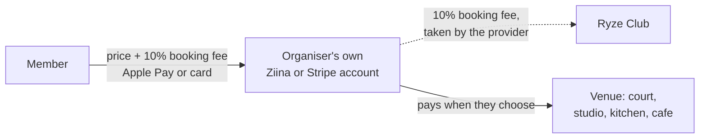

# Money flows

This replaces the earlier draft of the same date. That draft split venue shares, cost-share sessions and two kinds of fee. Every split was another rule for a host to learn and another reason to go back to WhatsApp. This version has one rule.

## The rule

> **Members pay the organiser's price plus a 10% booking fee. The organiser receives their price, minus the card fee, straight into their own account.**

Five things that follow from it:

- **There is one number to explain.** Members see "AED 60 + AED 6 booking fee", as on Eventbrite or a cinema site.
- **Organisers keep their whole price**, less the card fee they would pay with any card machine. A padel host passing on the court cost loses nothing, so cost-share and earning sessions need no separate rules.
- **Money arrives at booking, in the organiser's own Ziina or Stripe account**, on the provider's usual payout schedule. The organiser pays the court, the studio or the cafe deposit up front, as they do today. Ryze never holds the money, so nobody waits on Ryze.
- **Ryze's 10% is taken off automatically** by the provider as a platform fee on each payment.
- **There are no fee-free months to manage.** Organisers pay nothing to Ryze, so there is nothing to waive.

## Every type of club

AED per session, for one member.

| Club type | Example | Member pays | Organiser receives | Ryze |
|---|---|---:|---:|---:|
| Free club | Run club, beach volleyball, a free chess club | 0 | 0 | 0 |
| Cost-share | Padel court share, AED 60 | 66 | 60, less card fee; pays the court | 6 |
| Coach or instructor | Tennis clinic, AED 120 | 132 | 120, less card fee; pays the court | 12 |
| Studio class | Boxing studio, AED 90 | 99 | 90, less card fee | 9 |
| Book club, drink included | AED 70 | 77 | 70, less card fee; pays the cafe | 7 |
| Supper club or cooking class | AED 180 | 198 | 180, less card fee; buys ingredients, pays the kitchen | 18 |
| One-off workshop | Pottery taster, AED 250 | 275 | 250, less card fee | 25 |
| Club membership (dues) | Chess club, AED 50 a month | 55 a month | 50, less card fee | 5 a month |
| Ryze Mind Body Soul day | AED 295 | 295 | — (Ryze is the seller) | 295, less its costs |

The card fee is about 2.6% + AED 1 on Ziina. Confirm current rates with Ziina and Stripe.

**Pay per session or join.** Members can always pay for a single session. A membership or monthly pass is optional and the club decides whether to offer one. Nobody needs a Ryze membership.

## Cancellations

The organiser picks one cancellation rule when setting up the club:

| Organiser's rule | Member cancels in time | Member cancels late or doesn't turn up |
|---|---|---|
| Flexible: 24 hours | Price and booking fee refunded | Nothing back |
| Strict: no refunds | Nothing back; can give the spot to a friend | Nothing back |

If the club cancels (weather, illness, venue), members get everything back, including the booking fee, and their streak is protected (D28). The organiser refunds with one tap in the organiser app.

## Free clubs and chess clubs

- **A free club pays nothing and is charged nothing.** Free clubs are the shop window: newcomers find Ryze through them and then book paid sessions elsewhere. Charging them would send them back to WhatsApp.
- **A club that collects dues**, such as a chess club charging AED 50 a month for the cafe, uses the same rule: the member pays the dues plus 10%.
- **Why a club would use Ryze rather than WhatsApp and Instagram:** newcomers can find it, the organiser sees who is coming, dues and payments arrive without chasing, members build streaks, and photos land on one page. Ryze does not replace the WhatsApp chat (D9). It sits beside it, with links shared into the group (D35).
- **For a private club that doesn't want newcomers and doesn't collect money, Ryze adds little.** That is fine. They are not the customer. Whether open clubs value these things more than their current habit is still unproven, and the pilot must show it (concept verdict).

## Ryze's other income

These come later and are kept out of the member's and organiser's checkout:

- **Ryze Pro** for organisers who want passes, waitlists and payout reports (from 2028).
- **Venue partnerships**: cafes, studios and pitches paying to be featured.
- **Mind Body Soul days**: Ryze sells the tickets and pays its suppliers. This is the only case where Ryze holds money.

## How to build it

1. **Organiser connects once.** Ziina for individuals (Emirates ID), Stripe for clubs with a trade licence. This is already designed in the prototype ("Get paid").
2. **Organiser sets a price** per session, and later a monthly membership, plus a cancellation rule.
3. **Member taps "Pay AED 66 and book".** The provider's checkout shows Apple Pay, Google Pay and card. Ryze's 10% is attached to the payment as a platform fee, so the provider takes it off automatically.
4. **The provider confirms the payment to Ryze** (a webhook). The RSVP is marked paid and counts for the streak.
5. **Refunds** are issued from the organiser app. Ryze's fee is returned with them.
6. **The organiser sees** bookings, payments and refunds per session in the organiser app.

To confirm before building (open in `planning/parked.md`):

- Does Ziina support a platform fee on a payment made to an organiser's account? Its API has a "transfers" permission; ask Ziina how a platform takes its share.
- With Stripe Connect, the platform fee on each payment is the standard set-up. Check that Apple Pay still shows in the checkout when a platform fee is attached.
- Payout timing for each provider, so organisers know when booking money arrives.
- The wording of "booking fee" at checkout and on receipts, and VAT on Ryze's fee once Ryze registers.
