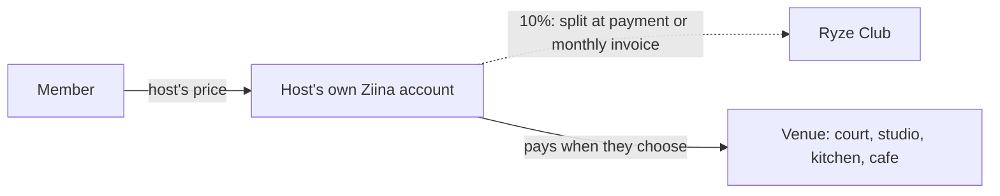

# Money flows

How money moves for every type of club, following D47 and D48. Earlier drafts proposed a member booking fee and cost-share rules (D54, D55); D47 superseded them.

## The rules

1. **Members pay the host's price, and that is the only price they see.** It goes straight into the host's own Ziina account (Stripe for clubs with a trade licence, in a later phase).
2. **Ryze keeps 10% of the host's price** (D47). How Ryze collects it is still open: a split at payment, or a monthly invoice to the host.
3. **The host pays the card fee**, as with any card machine.
4. **The host gets the money at booking**, on the provider's payout schedule. They pay the court, studio or cafe deposit up front, as they do today.
5. **Ryze never holds session money.**
6. **Private games and events with friends:** each guest pays their share plus AED 3 for Ryze, so the organiser gets their full share back (D47, D48).

## Every type of club

AED for one member and one session.

| Club type | Example | Member pays | Host receives (before card fee) | Ryze |
|---|---|---:|---:|---:|
| Free club | Run club, beach volleyball, free chess club | 0 | 0 | 0 |
| Shared court or pitch | Padel, AED 60 | 60 | 54; pays the court | 6 |
| Coach or instructor | Tennis clinic, AED 120 | 120 | 108; pays the court | 12 |
| Studio class | Boxing studio, AED 90 | 90 | 81 | 9 |
| Book club, drink included | AED 70 | 70 | 63; pays the cafe | 7 |
| Supper club or cooking class | AED 150 | 150 | 135; buys ingredients, pays the kitchen | 15 |
| Dance class | AED 60 | 60 | 54 | 6 |
| One-off workshop | Pottery taster, AED 250 | 250 | 225 | 25 |
| Private game or event with friends | 5-a-side, AED 40 share | 43 | 40 | 3 |
| Coaching (parked) | 1:1 session, AED 250 | 250 | 212.50 | 37.50 (15%) |

**Shared-court hosts.** When the price only covers the court, 10% comes out of the host's pocket: AED 24 on a AED 240 padel court. Private games (D48) are the fair route for groups that split a court among friends, because the AED 3 goes on top of each share. Ask the pilot hosts which route fits them.

## Private games and events (D48)

| Mode | How it works |
|---|---|
| **Already paid** | The host has paid the venue. Guests pay their share plus AED 3, which pays the host back |
| **Collect first** | Guests pay by a pay-by date. The host books only if the minimum is reached; otherwise nobody is charged |

**Paid means committed.** A guest who drops out gets their share back only if someone takes their spot, and Ryze keeps the AED 3. If the host cancels, everyone gets everything back.

## Cancellations for club sessions

| Case | Member gets back | Ryze's 10% |
|---|---|---|
| Member cancels within the host's refund window | Their payment | Returned |
| Member cancels late or doesn't turn up | Nothing | Kept |
| Host cancels | Everything; the streak is protected (D28) | Returned |

## Ryze's other income

**Venue commissions (parked idea 6).** Once Ryze brings venues regular weekly groups, venues pay a commission or give Ryze groups a lower rate. Ryze never books or pays venues for groups, and there is no paid placement (D43).

## To confirm before building

- Can Ziina take Ryze's 10% at payment? If not, invoice hosts monthly.
- Does Apple Pay still show in Ziina's checkout when a platform fee is attached?
- When does booking money reach the host?
- Fee-free months for new hosts: not decided. The forecast assumes none.
